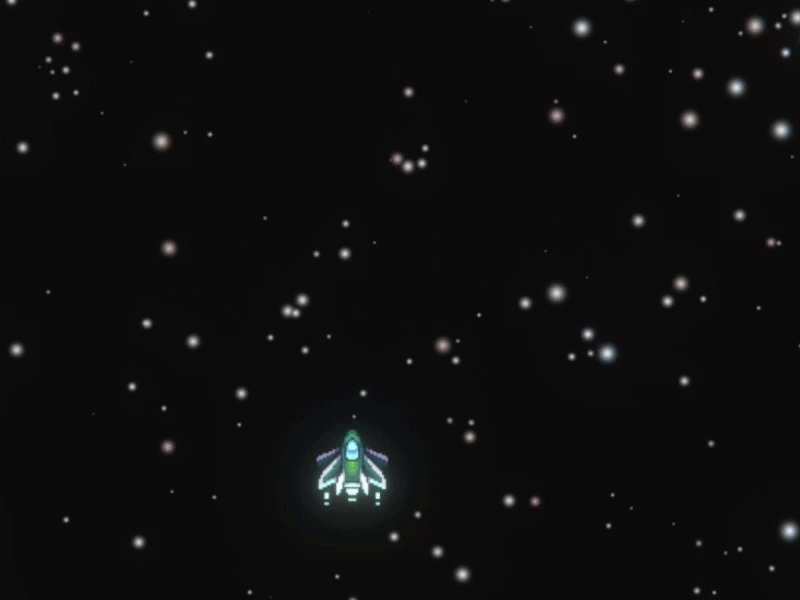

# Hey there! I'm Richard 👋

### 🎮 Gameplay Programmer | Indie Game Developer

I'm a Brazilian game developer passionate about creating interactive experiences, gameplay mechanics, and bringing ideas to life through code.

I've been developing games for approximately 5 years, working primarily with gameplay programming, but also with experience in game design and 2D pixel art.

In July 2025, I released my first commercial game on Steam, **Astral Wield**, after approximately 3 years of solo development.

Currently, I'm expanding my skills in Unity and C#, focusing on gameplay systems and 3D game development.

---

### 🛠️ Skills & Technologies

- **Languages:** C#, GML
- **Game Engines:** Unity, GameMaker
- **Specialties:** Gameplay Programming, Combat Systems, 2D Game Development
- **Additional Skills:** Game Design, Pixel Art, Unity Input System, Timeline

---

### 🚀 Featured Projects & Gameplay

#### ⚔️ 2D Platformer Combat System

A Unity 2D hack-and-slash prototype featuring light and heavy attacks, parrying, counterattacks, dashing, and gamepad support.

[View Source Code](https://github.com/rapidcrowgames/2D-Platformer-Combat-System)

---

#### 👹 Oni's Will Fall

A 2D game project developed using GameMaker and GML.

[View Repository](https://github.com/rapidcrowgames/Onis-Will-Fall)

---

#### 🚀 Space Shooter

A space shooter project developed in Unity using C#, featuring a boss encounter.

[View Repository](https://github.com/rapidcrowgames/Spaceshooter)

---

#### 🎨 Tintaforma

Gameplay preview from Tintaforma.

[▶ Watch Gameplay Preview](./Gif03-ezgif.com-video-to-gif-converter.gif)

---

#### 🌌 Astral Wield

My first commercially released indie game, developed over approximately 3 years and published on Steam in July 2025.

---

#### 👻 Marked for Hell (In Development)

A first-person psychological horror prototype developed in Unity, focusing on atmosphere, exploration, and interactive systems.

---

### 🌐 Portfolio

Check out my games, projects, and development experience!

[Visit My Portfolio](https://richardportfolio-app.base44.app/)

---

### 💼 Let's Connect!

I'm currently open to opportunities as a **Game Programmer / Gameplay Programmer**.

Always looking to improve my skills, collaborate with other developers, and create memorable gaming experiences.
